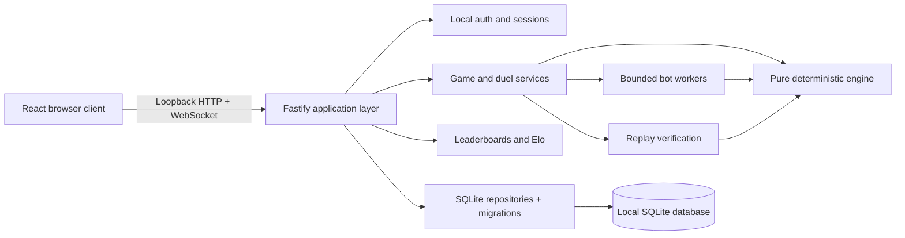

# Universal architecture — identical on all eight branches

## Stack and boundaries

Use a TypeScript monorepo, Node.js 24 LTS, npm workspaces with one root lockfile,
React + Vite browser client, Fastify loopback server, SQLite, a pure TypeScript
engine, and worker-based bot search. Use Vitest for unit/property/integration
checks and Playwright for browser/offline/accessibility flows. These are the
shared benchmark choices; a tool may propose a documented internal library
swap, but it must keep the public contracts and acceptance requirements intact.
The chief selects and locks actual package versions at M0. No fake application
package scripts are supplied in the baseline.



The browser never writes the database, posts a trusted final score, or determines
ranked outcomes. Services validate commands, invoke engine functions, commit
transactions, and publish committed events. UI animation consumes domain events
without becoming game state. Socket delivery happens after the database commit;
reconnecting clients can fetch events by sequence if delivery was interrupted.

## Required directory layout

```text
apps/
  web/                 React screens, input, themes, rendering, accessibility
  server/              HTTP routes, services, WebSocket, local auth, boot
packages/
  engine/              Immutable moves, PRNG, serialization, replay invariants
  contracts/           Shared types, schemas, OpenAPI, errors, version constants
  database/            Migrations, repositories, backup/restore
  bots/                Strategies, budgets, search workers, tournament helpers
  competition/         Challenge rules, duels, rankings, Elo, season policies
tests/
  fixtures/            Frozen public examples supplied by the benchmark
  acceptance/          Browser and API acceptance checks
  integration/         Cross-package and transaction checks
  performance/         Reproducible stress/fault scenarios
docs/                  Shared frozen benchmark requirements
prompts/               Shared chief / worker instructions
tools/                 Provider-neutral lab tools (already runnable)
reports/               Redacted, human-reviewed final reports
.lab/                  Ignored per-worktree environment / temporary artifacts
```

The baseline tracks directory README files, not a finished implementation.
At M0 create root `package.json`, `package-lock.json`, workspace packages,
TypeScript config, formatter/linter config, and these real commands:
`npm ci`, `npm run dev`, `npm run build`, `npm start`, `npm run lint`,
`npm run typecheck`, `npm test`, `npm run test:integration`, `npm run test:e2e`,
`npm run test:performance`, `npm run db:migrate`, `npm run db:backup`, and
`npm run db:restore -- <path>`. Production start serves bundled UI through the
loopback server. A command is not finished until it executes its advertised job.

## Dependency direction

- `contracts` has no runtime dependency on other workspace packages.
- `engine` depends only on contracts; it is browser/Node/worker compatible.
- `bots` depends on engine + contracts; it receives a cloned board and budget.
- `competition` depends on engine + contracts, never HTTP, browser, or SQL APIs.
- `database` implements persistence ports defined by service contracts.
- `server` wires ports/adapters together. Route handlers validate requests and
  call services; they do not contain merge logic or raw ranking calculations.
- `web` depends on contracts and presentation utilities, not SQL/server internals.

The same pure transition runs on backend, bot simulator, and replay checker.
Do not create three subtly different implementations of 2048.

## Ownership for chief plus five workers

| Role | Owns | May request changes from |
| --- | --- | --- |
| Chief | Root config/lockfile, `packages/contracts/`, integration, task plan | Every worker |
| Engine | `packages/engine/` and engine unit tests | Chief for contract changes |
| Backend | `apps/server/`, `packages/database/` and integration tests there | Chief, engine, competition |
| Frontend | `apps/web/` and its component tests | Chief, backend, quality |
| Competition | `packages/bots/`, `packages/competition/` and their tests | Chief, engine, backend |
| Quality | `tests/acceptance/`, `tests/integration/`, `tests/performance/`, report drafts | Every worker |

Quality does not rewrite implementation files while another worker owns them.
It files a repro/task and reviews the fix. The chief integrates reviewed commits
serially into `experiment/<software>`, never into `main`.

## Database model

| Table | Key fields / constraints |
| --- | --- |
| schema_migrations | version PK, checksum, applied_at |
| users | UUID PK, username_normalized UNIQUE, display_name, password_hash, deleted_at |
| sessions | token_hash UNIQUE, user_id FK, created_at, expires_at, revoked_at |
| profiles | user_id PK/FK, preferences JSON, aggregate statistics |
| rulesets | version PK, immutable canonical rules JSON, digest |
| seasons | ID PK, ruleset FK, start/end, status |
| challenges | ID PK, season/ruleset FK, seed, move_cap, status |
| challenge_attempts | account/challenge UNIQUE, game FK, status, official result |
| games | ID PK, owner nullable FK, mode, ruleset, engine version, seed, PRNG state, board JSON, score TEXT, revision, status |
| game_commands | game_id + command_id UNIQUE, normalized payload hash, response JSON; includes no-op/undo/forfeit outcomes |
| game_moves | game_id + revision UNIQUE, command_id UNIQUE per game, direction, events JSON, checksum |
| game_snapshots | game_id + revision UNIQUE, board/PRNG/score/state checksum |
| matches | ID PK, season/ruleset, seed, status, outcome, finalized_at |
| match_seats | match_id + seat UNIQUE, account or bot identity, game FK, terminal reason |
| ratings | account + season + ruleset UNIQUE, rating integer, played/won/drawn/lost |
| rating_events | match + account UNIQUE, before/after/delta/outcome |
| bot_runs | ID PK, bot version/config, budget, game/match FK, metrics |
| replay_exports | ID PK, game/match FK, schema version, checksum, created_at |

Use foreign keys and CHECK constraints to prevent invalid seat identities,
negative revisions, unknown states, and human/bot ranking contamination.
Index owner/status saves, challenge/account attempts, game event sequence,
match status, and season/ruleset standings. Scores sort by canonical decimal
length then binary lexical value. Rank over score length/value, max exponent
length/value, then created_at and ID for a total stable order; do not cast to REAL.

Only backend/database own the live file. Tests each use a private temporary
database; concurrent test suites must not share the production file. Each
experiment has its own runtime directory. The five implementation worktrees
share the run's mailbox; application processes run from the chief's integration
checkout after commits are integrated, using its one game database.

## Transactions and concurrency

Use optimistic revisions on game commands. Inside one transaction: validate
identity/ownership and command shape, detect an existing command ID and return
its stored response before checking the expected revision, then validate that
revision, apply the pure transition, write command response + move + snapshot,
update game counters, and finalize
match/rating if applicable. Commit before sending a socket event. A repeated
command ID with different payload is `IDEMPOTENCY_CONFLICT`, never a second move.
No-op responses are recorded in game_commands without adding a move or changing
revision/RNG. Never reuse a move-sequence unique key to store multiple no-ops.
Serialize competing commands for one game; parallel games may proceed through
the database writer queue. Use bounded queues and explicit busy responses.

Auth endpoints use same-origin validation and strict CORS. Require expected
Origin/Host for modifying browser requests and a CSRF token where appropriate.
Validate WebSocket Origin/session/seat ownership. Bind IPv4 loopback by default;
if supporting IPv6 bind `::1` deliberately, never `::` or `0.0.0.0`.
No LAN or public matchmaking is in scope. Request bodies, imports, events,
queues, bots, and exports have documented size/timeout limits.

## Save / replay / restart

Store the accepted move stream and periodic snapshots (every 50 accepted moves).
Replay from the nearest snapshot and verify the state checksum. Include engine,
ruleset, PRNG, and replay schema versions. Undo in casual modes restores full
state including PRNG and score; preserve an audit/branch marker so a replay does
not accidentally validate an undone move as the final path.

On restart, apply pending migrations before accepting requests, recover WAL,
load resumable games, and avoid rating an already finalized match twice.
In-progress bot jobs are cancelled/reconstructed, not silently counted as wins.
Migrations require preflight backups for destructive transforms; document how
to restore the backup with the app stopped. Integrity failures must surface.

## Performance and capacity

Use bounded lists and virtualized history where needed; never render all move
events in a single DOM tree. Separate animation clocks from authority.
Cache derived display strings without changing exact domain values. Measure on
the reference hardware recorded in each run, with warmup and raw sample counts.
See `ACCEPTANCE.md` for targets and `BENCHMARK.md` for fair-run controls.
